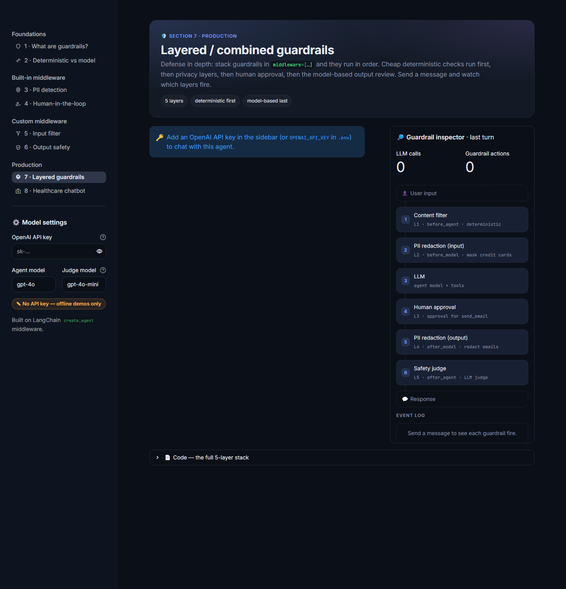
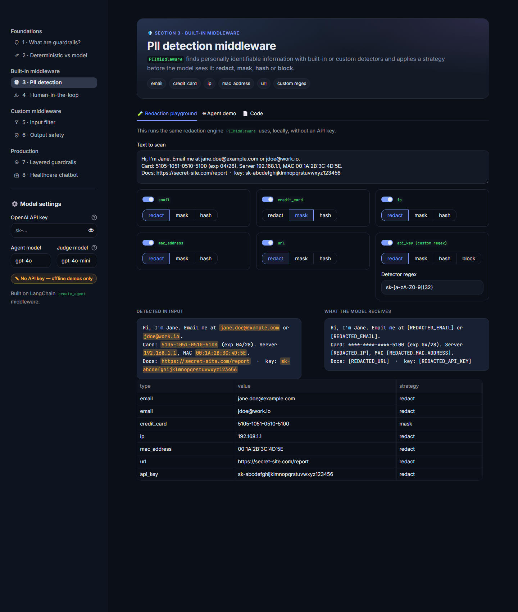

# 🛡️ Guardrails Studio

**An interactive Streamlit app for learning how to add guardrails to LangChain agents.**

Guardrails Studio turns a LangChain guardrails crash course into eight hands-on pages. On each page you can run a
guardrail against a live agent and see what it did: whether it **passed**, **blocked**, **modified** or **paused**
the request, and how many LLM calls the turn cost.

Built with LangChain 1.x `create_agent` middleware, LangGraph and Streamlit. Models are called through
[OpenRouter](https://openrouter.ai).



---

## ✨ What's inside

| # | Page | What you can do |
|---|------|-----------------|
| 1 | **What are guardrails?** | See where middleware hooks into an agent run (`before_agent`, `before_model`, tool gate, `after_agent`) |
| 2 | **Deterministic vs model-based** | Run keyword rules and an LLM judge on the same inputs and compare latency, verdicts and disagreements |
| 3 | **PII detection** | Try redact / mask / hash / block on emails, cards, IPs, URLs and custom regexes, offline; then chat with a PII-guarded agent |
| 4 | **Human-in-the-loop** | Choose which tools need approval, then **approve, edit or reject** tool calls from an approval card |
| 5 | **Input filter** | A custom `before_agent` hook; the LLM-call counter shows **0 calls** when a request is blocked |
| 6 | **Output safety** | A custom `after_agent` LLM judge with structured `SAFE` / `UNSAFE` verdicts and a fallback response |
| 7 | **Layered guardrails** | A 5-layer production stack with a live pipeline diagram |
| 8 | **Healthcare chatbot** | A guarded clinic assistant: harm filter, patient-PII redaction, staff approval for bookings, medical disclaimers |

Every chat page has a **guardrail inspector**: the request pipeline with each layer's status, an event log, and
counters for LLM calls and guardrail actions.



## 🚀 Quick start

You need Python 3.12+ and [uv](https://docs.astral.sh/uv/).

```bash
git clone <your-repo-url>
cd Langchain_Guardrails_project
uv sync
```

Create a `.env` file in the project root with your [OpenRouter API key](https://openrouter.ai/settings/keys):

```env
OPENROUTER_KEY=sk-or-...
```

Then start the app:

```bash
uv run streamlit run app.py
```

Open http://localhost:8501. You can also paste a key into the sidebar instead of using `.env`.
Pages 1–3 and the "dry run" checks work without a key.

### Models

The defaults are `openai/gpt-4o` for the agent and `openai/gpt-4o-mini` for the safety judge. You can switch
to any OpenRouter model that supports tool calling (e.g. `anthropic/claude-sonnet-4.5`) from the sidebar.

## 🧱 How it works

Every guardrail is LangChain **agent middleware**. The order of the `middleware=[…]` list is the order the layers run:

```python
agent = create_agent(
    model=llm,
    tools=[search_web, send_email],
    middleware=[
        ContentFilterMiddleware(["hack", "exploit", "malware"]),            # 1. deterministic input filter
        PIIMiddleware("credit_card", strategy="mask"),                      # 2. input privacy
        HumanInTheLoopMiddleware(interrupt_on={"send_email": True}),        # 3. human approval
        PIIMiddleware("email", strategy="redact",
                      apply_to_input=False, apply_to_output=True),          # 4. output privacy
        SafetyGuardrailMiddleware(judge_llm),                               # 5. LLM-as-judge on output
    ],
    checkpointer=InMemorySaver(),   # required for human-in-the-loop interrupts
)
```

Put cheap deterministic checks first and expensive model-based checks last. A request blocked at layer 1
never reaches an LLM.

### Project layout

```
app.py                  # entry point and navigation
views/                  # one page per course section (s1 … s8)
guardrails_app/
  middleware.py         # custom guardrails: content filter, safety judge, healthcare filter, disclaimer
  agents.py             # create_agent factories, one per section
  conversation.py       # runs turns, resumes human-in-the-loop, turns middleware effects into trace events
  guards.py             # deterministic vs model-based checks
  tracing.py            # thread-safe event log written by middleware
  settings.py           # OpenRouter connection and model settings
  ui.py                 # styling, pipeline diagram, chat, approval and inspector components
tests/                  # offline tests (fake chat model, Streamlit AppTest)
langchain_guardrails_crash_course.ipynb   # the original course notebook
```

## 🐞 Fixes compared with the course notebook

While building the app I found and fixed these issues in the notebook's patterns:

- **Input filters checked `messages[0]`.** On a conversation that keeps history, that is the first message ever
  sent, so later turns were never filtered. Filters now check the latest user message.
- **`jump_to: "end"` still runs every `after_agent` hook.** As a result, the output judge paid for an LLM call to
  review the guardrail's own refusal. Refusals are now tagged and skipped.
- **Output guards changed the message in place**, so the change wasn't saved to the checkpoint. They now
  replace the message by id.
- **The "output" PII layer also redacted the input**, because `apply_to_input` defaults to `True`. The agent then
  emailed `[REDACTED_EMAIL]`.
- **The healthcare filter's literal phrase `"drug synthesis"`** didn't match *"synthesize drugs"*. It now uses
  regex patterns.
- **Rejecting a human-in-the-loop call** now uses the `message` field from current LangChain (the notebook used `reason`).

## 🧪 Tests

```bash
uv run pytest
```

All 28 tests run **offline**, with no API key and no cost. They use a scripted fake chat model and Streamlit's
`AppTest`, and they cover every guardrail, every page rendering, and a full chat → approve → disclaimer flow in
the UI.

## 🙏 Credits

Based on the *Guardrails with LangChain* crash course by Krish Naik. See the
[LangChain guardrails docs](https://docs.langchain.com/oss/python/langchain/guardrails) for the underlying concepts.
